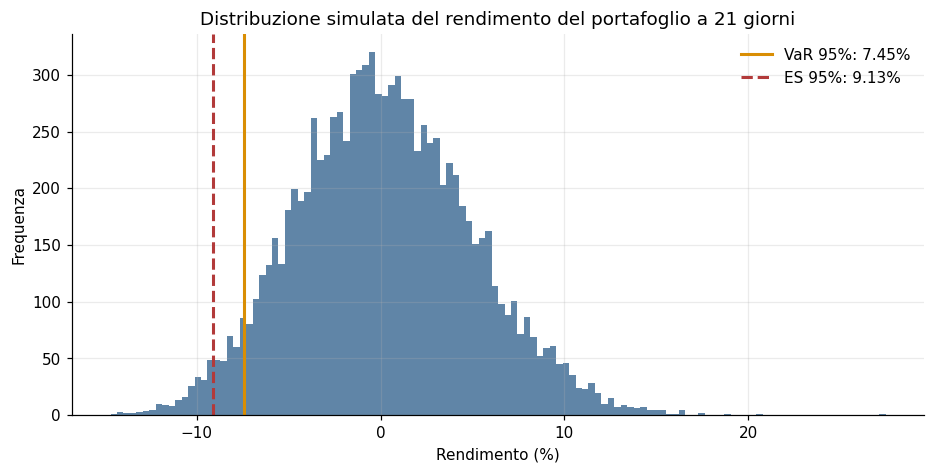
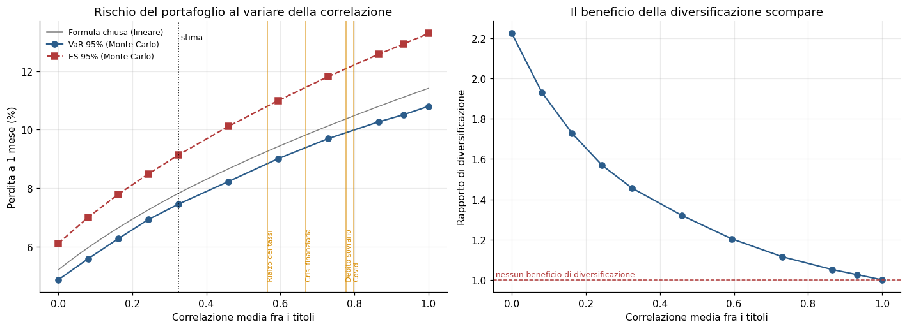
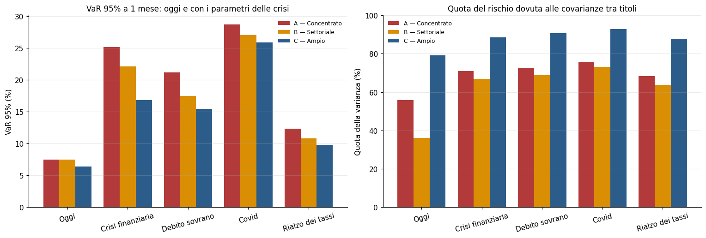
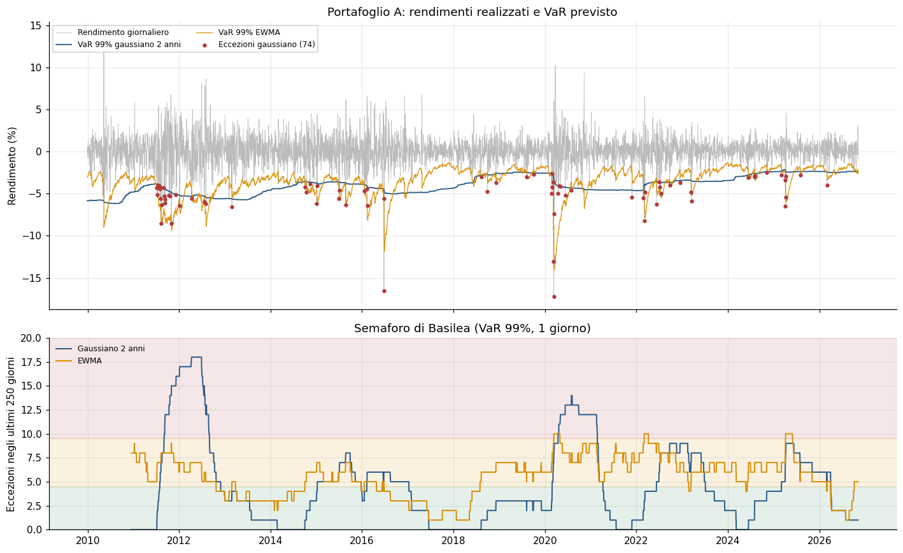
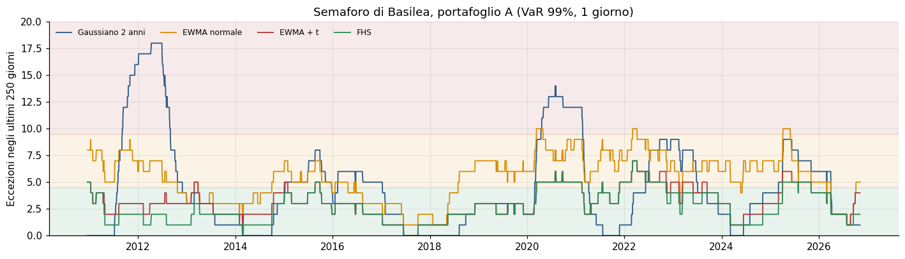
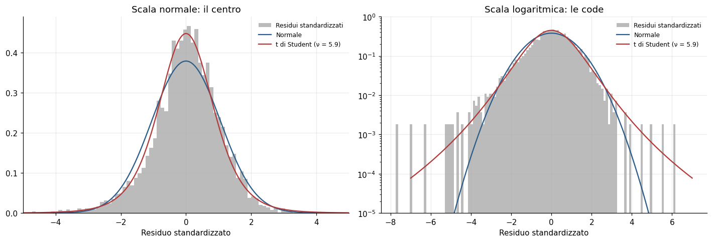

# Monte Carlo Portfolio Risk: VaR and Expected Shortfall on Italian Equities

[](https://colab.research.google.com/github/Lucaorlando01/montecarlo-var-ftse-mib/blob/main/Montecarlo_VaR_ES.ipynb)


A personal research project on the market risk of equity portfolios built from FTSE MIB stocks (2008–2026). It estimates one-month Value at Risk (VaR) and Expected Shortfall (ES) by correlated Monte Carlo simulation, studies how correlation and diversification behave in crises, and validates the model out of sample with regulatory backtests (Kupiec, Christoffersen, Basel traffic light).

The analysis is a single notebook that runs end to end in Google Colab with free data, so every number below can be reproduced with one click. The notebook is commented in Italian.

---

## Key findings

**1. Diversification protects against sector crises, not systemic ones.** A 20-stock, 7-sector portfolio has 15% lower VaR than a 5-stock portfolio concentrated in financials. Its advantage *widens* in crises centred on banks (2008: VaR ratio 0.67; 2011: 0.73), but almost vanishes in the systemic Covid shock (0.90).

**2. The more diversified the portfolio, the more its risk is correlation risk.** In the 20-stock portfolio, covariances account for 79% of variance today and 88–93% under crisis parameters, against 56% and 68–76% in the concentrated one. In crises, volatility and correlation rise together and their effects **multiply**: Covid parameters raise the concentrated portfolio's VaR by ×2.79 through volatility alone, ×1.34 through correlation alone and ×3.86 through both.

**3. The Gaussian model fails for four separable reasons, and fixing them in turn brings the model close to its target.** Out of sample (2010–2026), the 99% one-day Gaussian VaR has 73% more exceptions than expected, clustered in 2011 and 2020, and spends 12% of the time in the Basel red zone. The excess comes from four sources: time-varying volatility, residual scale, fat tails and negative skewness. Correcting them one at a time brings the excess down to **+14%** with zero time in the red zone. Filtered Historical Simulation (FHS) is the only model that passes both Kupiec and Christoffersen at the 99% level on both portfolios.

---

## Project structure

| Step | Question | Method |
|---|---|---|
| 1 | Are the data clean? | Adjusted prices from Yahoo Finance, check of extreme returns against known market events |
| 2 | What are the inputs? | Volatilities and correlations over a 2-year rolling window; μ = 0 by default |
| 3 | How do we simulate correlated returns? | Cholesky decomposition, 10,000 scenarios, 21-day horizon, full revaluation |
| 4 | How much can we lose? | VaR and ES at 95% / 99%, bootstrap confidence intervals, check against the closed form |
| 5 | How does risk depend on correlation? | Valid correlation stress ρ(t) = (1−t)ρ̂ + tJ, historical crisis parameters, volatility × correlation interaction |
| 6 | Does diversification help? | Three portfolios: concentrated, sector-diversified, broad |
| 7 | Is the model right out of sample? | Daily and monthly (non-overlapping) backtest, Kupiec, Christoffersen, Basel traffic light, EWMA benchmark |
| 8 | Are the tails fat? | EWMA + Student-t with ν re-estimated monthly; multivariate-t Monte Carlo |
| 9 | Where does the improvement come from? | Recalibrated EWMA and Filtered Historical Simulation: scale vs tail thickness vs asymmetry |

---

## Data

- **Source:** Yahoo Finance via `yfinance`, prices adjusted for dividends and corporate actions.
- **Period:** January 2008 – November 2026 (4,789 trading days).
- **Base portfolio (A):** Intesa Sanpaolo, UniCredit, Enel, Eni, Generali, equally weighted.
- **Data quality:** no daily return exceeds ±25%. The ten most extreme returns all match documented events: Brexit (24 June 2016, Italian banks around −23%), the €750bn euro-area rescue package (10 May 2010), the oil price collapse and the ECB press conference of March 2020, the October 2008 bank rescues and the Fed's first QE announcement (18 March 2009).

---

## Methodology in brief

Daily log-returns are modelled as $r_t \sim N(\mu, \Sigma)$. Over $h = 21$ days, $R_h \sim N(h\mu, h\Sigma)$. Correlated scenarios are generated as

$$R_h = h\mu + \sqrt{h}\,L z, \qquad \Sigma = LL^\top,\quad z \sim N(0, I)$$

The portfolio return uses full revaluation, $w^\top(e^{R_h} - 1)$, because weights apply to simple, not log, returns. VaR is minus the 5th (1st) percentile of simulated returns, and ES is minus the average of the worst 5% (1%).

In the linear Gaussian case VaR and ES have closed forms, which serve as an independent check of the simulation:

$$\text{VaR} = -(\mu_p + \sigma_p z_{1-\alpha}), \qquad \text{ES} = -\mu_p + \sigma_p\,\frac{\varphi(z_{1-\alpha})}{1-\alpha}$$

---

## Results

### Baseline: one-month VaR and ES (portfolio A, €100,000)

| Level | VaR | 95% CI | ES | 95% CI |
|---|---|---|---|---|
| 95% | 7.45% (€7,449) | [7.24%, 7.58%] | 9.13% (€9,131) | [8.95%, 9.32%] |
| 99% | 10.17% (€10,165) | [9.92%, 10.43%] | 11.40% (€11,400) | [11.08%, 11.72%] |

| Check (95%) | VaR | ES |
|---|---|---|
| Closed form (linear) | 7.82% | 9.81% |
| Monte Carlo, linear | 7.91% | 9.78% |
| Monte Carlo, full revaluation | 7.45% | 9.13% |
| Monte Carlo **without** correlation (wrong) | 4.86% | 6.11% |

The simulation matches the closed form within Monte Carlo error. Ignoring correlation, that is skipping the Cholesky step, would understate VaR by about a third.

<p align="center"></p>

### Correlation and crises (Step 5)

Moving the average correlation from its current level (0.32) to perfect correlation raises VaR by 45%. With only 5 stocks, though, the growth is concave: portfolio volatility scales roughly as $\sqrt{1/n + (1-1/n)\bar\rho}$.

<p align="center"></p>

Crisis parameters applied to today's portfolio A:

| Crisis | Avg. correlation | Avg. volatility | × correlation only | × volatility only | × both |
|---|---|---|---|---|---|
| Today (estimation window) | 0.32 | 24.0% | – | – | – |
| Financial crisis (2008–09) | 0.67 | 72.3% | ×1.26 | ×2.69 | ×3.38 |
| Sovereign debt (2011) | 0.78 | 56.3% | ×1.32 | ×2.29 | ×2.85 |
| Covid (2020) | 0.80 | 78.2% | ×1.34 | ×2.79 | ×3.86 |
| Rate hikes (2022) | 0.57 | 34.3% | ×1.18 | ×1.41 | ×1.66 |

In a small concentrated portfolio the volatility shock dominates. The two effects compound multiplicatively: the combined effect exceeds the sum of the separate ones by up to 5.4 percentage points of VaR.

### Diversification (Step 6)

| Portfolio | Stocks | Sectors | Avg. corr. | Avg. stock vol. | Portfolio vol. | VaR 95% | Diversification ratio | Covariance share |
|---|---|---|---|---|---|---|---|---|
| A — Concentrated | 5 | 3 | 0.32 | 24.0% | 16.5% | 7.45% | 1.46 | 56% |
| B — Sector-diversified | 5 | 5 | 0.17 | 28.9% | 16.8% | 7.50% | 1.71 | 36% |
| C — Broad | 20 | 7 | 0.23 | 28.4% | 14.5% | 6.37% | 1.98 | 79% |

The hypotheses were stated before looking at the results:

- **H1 — partly confirmed.** C is the least risky. B is not less risky than A: its much lower correlation is offset by more volatile constituents. The simple formula $\bar\sigma\sqrt{1/n + (1-1/n)\bar\rho}$ reproduces all three portfolio volatilities within 0.3 points.
- **H2 — rejected, with one exception.** The ratio VaR(C)/VaR(A) falls from 0.85 today to 0.67 (2008), 0.73 (2011) and 0.79 (2022), so diversification helps *more* in sector-specific crises. It rises to 0.90 only in Covid, the one truly systemic shock.
- **H3 — confirmed.** Correlation matters more in C: higher covariance share, and a larger "correlation only" multiplier in every crisis (Covid: ×1.66 vs ×1.34).

<p align="center"></p>

### Backtesting (Steps 7–9)

VaR is forecast each day using only past data, from December 2009 to November 2026: 4,284 daily observations and 204 non-overlapping months. All five models are compared on the same sample.

<p align="center"></p>

**Excess of exceptions over expected, 1-day VaR (0% = perfect):**

| Model | A, 95% | A, 99% | C, 95% | C, 99% |
|---|---|---|---|---|
| Gaussian, 2-year window | −15% | +73% | −10% | +66% |
| EWMA (λ = 0.94), normal | +13% | +126% | +19% | +122% |
| EWMA, normal, recalibrated scale | −1% | +80% | +6% | +89% |
| EWMA + Student-t | +7% | +33% | +13% | +45% |
| Filtered Historical Simulation | −15% | **+14%** | −8% | **+19%** |

**99% one-day VaR, portfolio A:**

| Model | Exceptions (exp. 42.8) | Kupiec p | Christoffersen p | π₁₁ / π₀₁ | Basel red zone |
|---|---|---|---|---|---|
| Gaussian, 2-year window | 74 | 0.000 | 0.000 | 8.1 | 12% of time |
| EWMA, normal | 97 | 0.000 | 0.262 | 1.9 | 2% |
| EWMA, recalibrated | 77 | 0.000 | 0.064 | 3.1 | 0% |
| EWMA + Student-t | 57 | 0.038 | 0.789 | 1.4 | 0% |
| **FHS** | **49** | **0.355** | **0.592** | 1.8 | **0%** |

**Reading the ladder.** The Gaussian 2-year model reacts too slowly. In 2011 it records 16 exceptions against 2.6 expected, and after crises it stays too conservative. EWMA removes the clustering at 99% but has too many exceptions. Splitting the remaining improvement shows that on portfolio A about **41%** comes from recalibrating the residual scale, **42%** from fat tails and **17%** from asymmetry (portfolio C: 32% / 43% / 25%). Without the recalibrated model as a control, the Student-t would have been credited with the scale effect too.

<p align="center"></p>

| Model (portfolio A, 99%) | Green | Yellow | Red |
|---|---|---|---|
| Gaussian, 2-year window | 59% | 29% | 12% |
| EWMA, normal | 30% | 68% | 2% |
| EWMA, recalibrated | 50% | 50% | 0% |
| EWMA + Student-t | 79% | 21% | 0% |
| FHS | 83% | 17% | 0% |

### Fat tails and asymmetry (Steps 8–9)

EWMA-standardised residuals of portfolio A have excess kurtosis 2.89 and skewness −0.50. The estimated Student-t degrees of freedom range from 5.7 to 10.3. Residuals beyond 4 standard deviations are 47 times more frequent than under normality, and beyond 5 standard deviations about 2,200 times. Losses dominate the left tail: beyond 3 standard deviations there are 38 losses and 11 gains, against about 25 per side under a symmetric t.

<p align="center"></p>

Multivariate-t Monte Carlo with the same covariance as the Gaussian (ν = 5.9):

| Horizon | VaR 95% t/N | VaR 99% t/N | ES 95% t/N | ES 99% t/N |
|---|---|---|---|---|
| 1 day | ×0.97 | ×1.11 | ×1.08 | **×1.24** |
| 21 days | ×1.00 | ×1.01 | ×1.01 | ×1.02 |

Fat tails matter most for the 99% ES, which supports the regulatory move from VaR to ES (FRTB). Under i.i.d. sampling they wash out at the monthly horizon by the central limit theorem. In practice, monthly tails stay fat because volatility clusters, which only a dynamic model such as EWMA captures.

---

## How the code was validated

- **Closed form.** Monte Carlo VaR/ES match the analytical Gaussian values within simulation error.
- **Synthetic data with known parameters.** Estimation recovers the true volatilities and correlations, and the simulated correlation matches the target matrix.
- **Statistical tests.** Kupiec and Christoffersen do not reject random exceptions and do reject clustered ones.
- **Positive controls for the models.**
  - On GARCH data with t(5) innovations, the estimated ν falls between 4.1 and 5.1, and EWMA + t produces 40 exceptions against 40 expected, while EWMA-normal produces 74.
  - On skewed fat-tailed data, the excess exceptions fall step by step: +141% (EWMA) → +106% (recalibrated) → +69% (t) → −8% (FHS).
- **No look-ahead.** Every daily forecast uses only data available up to the previous day, and ν, scale and FHS quantiles are re-estimated every 21 days on past residuals only.

---

## Limitations

- **Clustering at 95%.** Exceptions remain clustered at the 95% level for every model (π₁₁ ≈ 2 × π₀₁). The problem lies in the volatility dynamics, not in the distribution: EWMA reacts with a lag and symmetrically to gains and losses.
- **No single best model.** FHS is too conservative at 95% on portfolio A (183 exceptions against 214 expected), because it carries residuals from 2008–2011 when EWMA lagged. The best model is recalibrated EWMA at 95% and FHS at 99%.
- **Low power at the monthly horizon.** With 204 months, "not rejected" at 21 days is weak evidence.
- **Short crisis windows.** Crisis-window estimates are noisy (Covid: about 50 observations for 190 correlations in portfolio C).
- **Survivorship bias.** All stocks are listed today and were listed in 2008.
- **Weights and tails.** Weights are equal per stock, not per sector, and the multivariate t uses a single ν for all stocks.

## Future work

1. **GJR-GARCH** volatility, which reacts more to losses than to gains, to remove the residual clustering.
2. **Skewed Student-t** (Hansen, 1994): asymmetry while keeping the ability to extrapolate beyond observed losses.
3. **Expected Shortfall backtesting** (Acerbi and Székely, 2014).
4. **FOMC announcement days:** correlations, residuals and exceptions on Fed announcement days against other days.
5. **Component VaR:** each stock's contribution to portfolio risk.

---

## How to run

**In the browser (no installation):** click the *Open in Colab* badge above, then *Runtime → Run all*. A full run takes a few minutes, mostly for the download.

**Locally:**

```bash
git clone https://github.com/Lucaorlando01/montecarlo-var-ftse-mib.git
cd montecarlo-var-ftse-mib
pip install -r requirements.txt
jupyter notebook Montecarlo_VaR_ES.ipynb
```

All choices (tickers, weights, horizon, number of simulations, μ = 0, seed) live in the configuration cell at the top. Setting `USA_DATI_SINTETICI = True` runs the whole notebook offline on synthetic data, for testing only.

---

## References

- Barone-Adesi, G., Giannopoulos, K. and Vosper, L. (1999). VaR without correlations for portfolios of derivative securities. *Journal of Futures Markets*, 19(5).
- Basel Committee on Banking Supervision (1996). *Supervisory framework for the use of "backtesting" in conjunction with the internal models approach to market risk capital requirements.*
- Basel Committee on Banking Supervision (2019). *Minimum capital requirements for market risk* (FRTB).
- Christoffersen, P. (1998). Evaluating interval forecasts. *International Economic Review*, 39(4).
- Glosten, L., Jagannathan, R. and Runkle, D. (1993). On the relation between the expected value and the volatility of the nominal excess return on stocks. *Journal of Finance*, 48(5).
- Hansen, B. (1994). Autoregressive conditional density estimation. *International Economic Review*, 35(3).
- J.P. Morgan / Reuters (1996). *RiskMetrics — Technical Document*, 4th edition.
- Kupiec, P. (1995). Techniques for verifying the accuracy of risk measurement models. *Journal of Derivatives*, 3(2).
- McNeil, A., Frey, R. and Embrechts, P. (2015). *Quantitative Risk Management*, revised edition. Princeton University Press.

---

**Author:** Luca Orlando — MSc candidate in Corporate Finance and Financial Markets, University of Turin.

*This project is for research and educational purposes only and does not constitute investment advice.*
